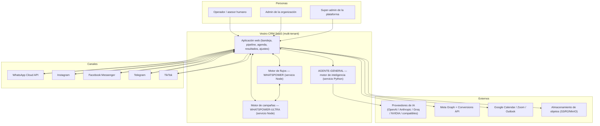
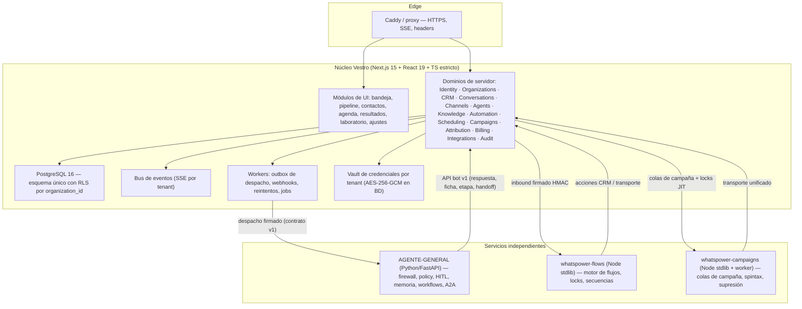
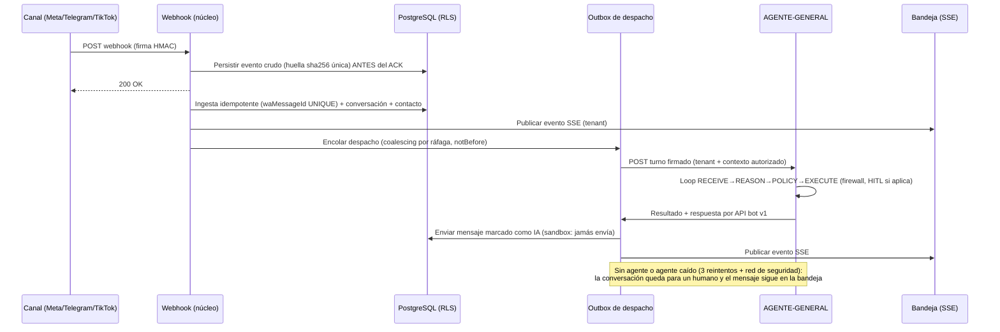

# ARQUITECTURA_MAESTRA_CRM.md

**Proyecto:** Construcción del nuevo CRM SaaS multi-tenant — plataforma empresarial para AGENTE-GENERAL
**Fase:** 3 — Arquitectura maestra y modelo de datos
**Fecha:** 2026-11-27
**Documentos hermanos:** `REPOSITORIOS_AUDITORIA.md`, `MATRIZ_PARIDAD_VOCERO.md`, `MATRIZ_LICENCIAS.md`, `MODELO_MULTI_TENANT.md`, `CONTRATOS_INTEGRACION.md`, `ROADMAP_CONSTRUCCION.md`, `RIESGOS_TECNICOS.md`

---

## 1. Visión

Una **plataforma SaaS empresarial, omnicanal y multi-tenant**, organizada como un **chaleco**: el entorno de trabajo completo donde AGENTE-GENERAL (el único motor central de inteligencia) opera con herramientas autorizadas sobre los datos comerciales de cada organización.

Tres reglas que la definen y que no se negocian:

1. **Un cerebro, un chaleco, módulos intercambiables.** La inteligencia vive en AGENTE-GENERAL y nunca se duplica. El CRM es el entorno empresarial. WHATSPOWER (flujos) y WHATSPOWER-ULTRA (campañas) son módulos independientes que se conectan por adaptadores; su indisponibilidad degrada su función, jamás la bandeja ni el pipeline.
2. **No se pegan seis proyectos.** Los límites y contratos se definen primero; el código entra solo cuando su licencia lo permite (`MATRIZ_LICENCIAS.md`) y su arquitectura cabe en un dominio.
3. **Paridad de VOCERO garantizada.** Las 156 capacidades inventariadas siguen disponibles (`MATRIZ_PARIDAD_VOCERO.md`); ninguna funcionalidad se elimina por considerarse secundaria.

## 2. Principios arquitectónicos

| # | Principio | Consecuencia concreta |
|---|---|---|
| P1 | **Multi-tenancy real desde el diseño** | `organization_id` en toda entidad empresarial + RLS en PostgreSQL + pruebas automatizadas de fuga (`MODELO_MULTI_TENANT.md`) |
| P2 | **El agente no toca la base de datos** | AGENTE-GENERAL se comunica solo por el adaptador versionado; toda operación lleva tenant, agente, usuario, permisos, idempotencia y auditoría |
| P3 | **Contratos primero** | Cada módulo publica contrato versionado (REST/OpenAPI + eventos); nada se integra por esquema de BD compartido |
| P4 | **Conservar comportamiento, reorganizar implementación** | Los contratos y códigos de error publicados por VOCERO no se rompen; las reorganizaciones internas van con specs y pruebas de vigilancia |
| P5 | **Solo APIs oficiales de canales** | WhatsApp Cloud API, Instagram/Messenger Graph, Telegram Bot API, TikTok por su API oficial/transporte unificado; nada de transportes no oficiales en el producto comercial |
| P6 | **Idempotencia y clasificación honesta** | Todo envío y todo webhook: clave de idempotencia + resultado SENT/REJECTED/UNCERTAIN; jamás reintentos ciegos de lo uncertain |
| P7 | **Seguridad por defecto (fail-closed)** | Firewall/policy/HITL del agente; sin envío real sin autorización explícita; credenciales cifradas en reposo; sin acceso entre tenants |
| P8 | **Sin botones muertos ni integraciones simuladas** | Todo control visible ejecuta una acción real y verificable en E2E |
| P9 | **Espanol como idioma de código, UI y docs** (constitución heredada de VOCERO) | Los identificadores de producto internos siguen la convención existente |
| P10 | **Todo módulo con responsabilidad, contrato, documentación, pruebas, observabilidad, recuperación y criterios de aceptación** | Gate por fase en el roadmap |

## 3. Identidad propia propuesta (sección 17 del mandato)

| Elemento | Propuesta |
|---|---|
| **Nombre de trabajo** | **Vestro** — de «chaleco» (veste/vestir): el equipo que viste y equipa al agente. Corto, pronunciable en español, neutro para SaaS |
| Alternativas | **Coraza CRM** (protección), **Vestia** (elegancia), **Nexo CRM** (conexión). El concepto interno «chaleco» queda como nombre de proyecto, no como marca |
| Tagline | «El chaleco empresarial de tu agente de IA» |
| Color primario | Azul marino `#0B2447` (continuidad con la barra lateral de VOCERO) |
| Color de acento | Teal `#14B8A6` (acción, estado IA); ámbar `#F59E0B` (avisos/escalado humano) |
| Neutros | Escala slate (`#0F172A → #F8FAFC`) con modo claro/oscuro AA |
| Tipografía | **Archivo** (display) + **Inter** (texto) — ya self-hosted con licencia OFL en el código de VOCERO; cero dependencia de fuentes con riesgo |
| Iconografía | Sistema propio derivado de lucide (ISC) con estilo unificado; logotipo nuevo (pendiente de diseño gráfico, fuera del alcance de esta fase) |
| Reglas de marca | Ninguna marca de referencia en la UI; avisos MIT/OFL en `THIRD_PARTY_NOTICES`; el tenant aplica su propia marca blanca encima |

## 4. Diagrama de contexto (C4 nivel 1)



## 5. Diagrama de contenedores (C4 nivel 2)



## 6. Flujo de referencia: mensaje entrante → agente → respuesta



## 7. Módulos (los 14 dominios + plataforma)

Cada módulo se define con: responsabilidad, contrato, datos clave, pruebas, observabilidad y criterios de aceptación. Los dominios siguen el mandato (sección 12).

| Dominio | Responsabilidad | Contrato | Datos clave | Pruebas | Observabilidad | Criterios de aceptación |
|---|---|---|---|---|---|---|
| **Identity** | Usuarios, sesiones, roles de equipo, invitaciones, 2FA | Sesiones cookie + API de equipo | `user`, `member`, `invitation`, `two_factor` | Tests unitarios + E2E de login/invitación | Eventos de auth en audit | Login/invitación/2FA E2E; registro público cerrado por defecto |
| **Organizations** | Tenants, planes, límites, onboarding, super-admin | `/v1/organizations` (admin global), switch-organization | `organization`, `plan`, `subscription`, `usage_limit` | Tests negativos de aislamiento | Métricas por tenant | Crear/limitar/suspender org sin fuga de datos |
| **CRM** | Contactos, empresas, leads/pipeline, cotizaciones, productos, notas, etiquetas, ficha, tareas | `/v1/contacts`, `/v1/leads`, `/v1/quotes`, `/v1/products`, `/v1/tasks` | `contact`, `company`, `lead`, `pipeline_stage`, `lead_stage_event`, `quote`, `product`, `task`, `contact_tag` | Paridad kanban + bitácora append-only vigilada | Actividad en audit; métricas de pipeline | Kanban E2E paridad; bitácora no editable; sin leads duplicados |
| **Conversations** | Bandeja, mensajes, adjuntos, estados, ventana, handoff, notas, reacciones, búsqueda, eventos de hilo | `/v1/conversations*` + `/api/bot/*` (compat) | `conversation`, `message`, `media_asset`, `conversation_note`, `conversation_pin`, `message_reaction` | Guiones E2E de VOCERO (59) como base de regresión | SSE por tenant; trazas de envío | Bandeja E2E completa; códigos 409 tipados intactos |
| **Channels** | Conexiones por canal, webhooks, plantillas, embedded signup, capacidades por canal | Webhooks firmados + `/v1/channels` | `meta_credentials`, `instagram_credentials`, `messenger_credentials`, `tiktok_credentials`, `telegram_credentials`, `template`, `webhook_event` | Mocks de Graph (patrón wa-mock) + firma HMAC | Estado de conexiones (pantalla Estado) | Conectar/desconectar/probar cada canal E2E; persistir antes de ACK |
| **Agents** | Agentes lógicos por org (perfil, especialización, roles/herramientas), despacho al cerebro, salud del cerebro | Contrato bot v1 + despacho firmado | `agent_profile`, `dispatch`, `ia_vuelta` | Tests de despacho, coalescing, red de seguridad, sandbox | Outbox con métricas de latencia/fallos | Despacho E2E con mock del agente; sin agente → bandeja manual |
| **Knowledge** | Base de conocimiento por organización, compartible por cualquier agente compatible | `/v1/knowledge` + MCP `list/add/update/delete_knowledge` | `kb_entry` (+ `kb_embedding` opcional) | CRUD E2E; tamaño (`/knowledge/size`) | Uso en audit | KB usable desde 2 consumidores distintos sin acoplamiento al modelo |
| **Automation** | Secuencias, triggers de pipeline, temporizadores (delega en motor de flujos), automatizaciones no conversacionales | Contrato del adaptador de flujos (`CONTRATOS_INTEGRACION.md` §8) | Delegado (motor de flujos) + `automation_rule` espejo | Tests del motor (248 casos existentes) + adaptador | Journal de efectos; UNCERTAIN reconciliado | Un flujo dispara acciones CRM; pausa del motor no afecta bandeja |
| **Scheduling** | Agenda universal, conectores (enlace, Zoom, Google, Outlook), ofertas y reservas | Contrato de conectores (4 ops) + `/v1/bookings` | `calendar_settings`, `booking`, `offered_slot`, `zoom/google/outlook_credentials` | Tests de race de booking + conectores | Estado de conectores | Solo se reserva lo ofrecido; sin doble booking; cita cae igual si el proveedor falla |
| **Campaigns** | Campañas (delega en motor ULTRA): audiencias, plantillas, spintax, programación, supresión, consentimiento | Contrato del adaptador de campañas (§9) | Delegado (motor de campañas) + `audience`/`suppression` espejo | Tests del motor (198 casos) + adaptador | Monitor de campaña en UI | Pausa/reanudación/cancelación E2E; sin envío sin consentimiento; pacing por tenant |
| **Attribution** | CTWA, UTMs, deduplicación, Meta CAPI, eventos de conversión | `/v1/attribution/*` + settings CAPI | `ad_attribution`, `conversion_event`, `capi_settings` | Deduplicación + fallo de Meta no bloquea | Tabla de actividad CAPI | Eventos dedup; conversación nunca bloqueada por CAPI |
| **Billing** | Planes, suscripciones, pruebas, facturación, consumo (usuarios, conversaciones, IA, canales), suspensión/reactivación | `/v1/billing/*` + admin global | `plan`, `subscription`, `invoice`, `usage_record`, `ai_consumption` | Tests de límites y corte por agotamiento | Métricas de consumo por tenant | Exceder límite degrada con mensaje claro, nunca pierde datos |
| **Integrations** | API pública v1, MCP, OAuth, llaves, conectores externos, adaptador del agente | OpenAPI 3.1 por instancia + MCP JSON-RPC | `api_key`, `oauth_client`, `oauth_grant`, `oauth_token` | Guiones E2E de API/MCP de VOCERO | Contadores de uso por llave | OAuth PKCE E2E; MCP sin permiso de envío; límites por plan |
| **Audit** | Bitácora general tamper-evident por tenant (todas las operaciones sensibles) | Consulta por UI/API admin | `audit_log` (append-only + cadena hash, patrón de AGENTE-GENERAL) | Verificador de cadena en CI | Export por tenant | Toda operación del adaptador queda auditada; cadena verificable |
| **Platform (transversal)** | Deploy, installer guiado, doctor, seed, PWA, branding, temas, notificaciones | — | `branding`, `onboarding` | Self-test Playwright + doctor | Health `/api/health` versionado | Doctor verde en instalación limpia; PWA instalable; paridad visual |

## 8. Decisiones de stack (post-auditoría)

| Decisión | Elección | Justificación con evidencia |
|---|---|---|
| Framework del núcleo | **Next.js 15 App Router + React 19 + TypeScript estricto** (no Next 16 por ahora) | VOCERO (la base funcional principal) opera en Next 15.5 con 142 rutas probadas; migrar a 16 es trabajo extra sin valor de paridad. CRM-ALBRA/CRM-WHATSAPP usan Next 16 pero su código no entra al núcleo. Se evaluará el upgrade como ADR separado post-F12 |
| ORM/BD | **Drizzle ORM + PostgreSQL 16**, migraciones versionadas aplicadas al arranque | 43 tablas y 33 migraciones de VOCERO reutilizables; esquema ya org-scoped; Prisma/SQLite de CRM-ALBRA no entra (SQLite no apto para SaaS multi-nodo según su propio `CONTEXT.md`) |
| Auth | **better-auth + plugin organization** | Ya probado en VOCERO con organizaciones y roles; la autenticación propia de CRM-ALBRA queda como especificación para 2FA/RBAC fino |
| UI | Tailwind + tokens + componentes propios (patrón shadcn) | Continuidad con VOCERO (103 componentes); shadcn de CRM-ALBRA como referencia de componentes |
| Tiempo real | SSE por tenant con bus compartible entre réplicas | SSE ya probado; el bus in-process se adapta (backplane) para multi-replica en F5 |
| Colas/trabajo en fondo | Outbox + workers propios del núcleo; jobs durables del agente para workflows del agente | Patrón outbox ya existente (despacho, webhooks, automatizaciones CRM-ALBRA); sin RabbitMQ/Kafka en MVP — colas externas solo si el volumen lo exige (ADR abierto) |
| Servicios satélite | **AGENTE-GENERAL** (Python/FastAPI) intacto; **flujos** (WHATSPOWER) y **campañas** (ULTRA) como servicios Node stdlib sin dependencias | Cero dependencias = despliegue simple y aislamiento real; el CRM no reimplementa sus motores |
| Almacenamiento de medios | Disco local por defecto + S3/R2/MinIO opcional con firma SigV4 propia (sin SDK AWS) | Código ya probado en VOCERO (`storage/objetos.ts`); rutas por tenant |
| Proxy de borde | Caddy (HTTPS automático, SSE flush) | Probado en VOCERO y CRM-ALBRA |
| Contenedores | Docker multi-stage; compose de plataforma: `app`, `postgres`, `agent`, `flows`, `campaigns`, `caddy`, (opcional `minio`) | Base compose de VOCERO extendida a los satélites |
| Idioma del código/UI/docs | Español | Constitución de VOCERO; consistente con el ecosistema |

**Monorepo propuesto (pnpm workspace, ya usado por VOCERO):**

```
plataforma/
  apps/web/            # núcleo Next.js (dominios en src/server/<dominio>)
  services/agent/      # AGENTE-GENERAL (submódulo/upstream Python, sin modificar)
  services/flows/      # motor de flujos (WHATSPOWER adaptado)
  services/campaigns/  # motor de campañas (ULTRA adaptado o clean-room)
  packages/contracts/  # contratos compartidos: openapi, zod, tipos de eventos
  infra/               # docker-compose, Caddy, manifests PaaS, installer, doctor
  docs/                # los 8 documentos obligatorios + specs SDD nuevas
```

## 9. Estrategia de composición (qué se conserva, adapta, reconstruye)

| Componente | Disposición | Origen |
|---|---|---|
| Dominios Identity/CRM/Conversations/Channels/Agents/Knowledge/Scheduling/Attribution/Integrations | **Conservar/Adaptar** desde VOCERO | `vocero-crm` (MIT) |
| Motor de inteligencia | **Conservar intacto** como servicio | `AGENTE-GENERAL` (MIT) |
| Motor de flujos | **Conservar casi íntegro** como servicio (adaptar `crm-client`, reglas hard-coded, retirar UI embebida) | `WHATSPOWER` (MIT) |
| Motor de campañas | **Adaptar** como servicio (pending licencia; si no, clean-room desde su FICHA) | `WHATSPOWER-ULTRA` (sin licencia) |
| Seguridad multi-tenant (RLS, RBAC fino, 2FA, auditoría tamper-evident) | **Reconstruir** con especificación de CRM-ALBRA + patrón de auditoría de AGENTE-GENERAL | Especificación, no código |
| Instalador guiado + biblioteca sectorial | **Reconstruir** siguiendo patrones de CRM-WHATSAPP con contenido original | Patrones MIT, contenido nuevo |
| Billing/planes/límites | **Reconstruir** nuevo | — |
| UI Studio de flujos | **Reconstruir** dentro de la UI de la plataforma (el motor queda sin UI embebida) | Motor WHATSPOWER expone API JSON de flujos |
| Motor de transporte TikTok/Zernio | **Adaptar** como adaptador de canal con contrato propio | `vocero-crm` `zernio/` |

## 10. Multi-tenancy (resumen)

Base: **una sola BD PostgreSQL con RLS por `organization_id`**, propagación explícita de contexto de tenant en HTTP → servicios → workers → jobs → SSE → MCP → webhooks, credenciales y archivos segregados por organización, y una batería de pruebas automatizadas que intenta cruzar tenants y demuestra que está bloqueado. Detalle completo: `MODELO_MULTI_TENANT.md`.

## 11. Seguridad y cumplimiento

- **Cifrado en reposo** de todas las credenciales de canales, IA, calendarios y CAPI (AES-256-GCM, patrón de VOCERO), con lookup por hash y comparación timing-safe (mejora inspirada en la especificación de CRM-ALBRA).
- **Webhooks autenticados en dos capas** (token de URL timing-safe + firma HMAC del proveedor) y persistencia del evento antes del ACK con huella única.
- **Firewall de acciones del agente:** default-deny (ActionFirewall + PolicyEngine + autonomía L0-L5 + HITL con aprobaciones durables) — capacidad nativa de AGENTE-GENERAL, jamás reimplementada en el CRM.
- **Operaciones sensibles con aprobación humana** en la UI de la plataforma (el CRM consulta `GET /api/v1/approvals/pending` del agente y presenta la cola de aprobaciones).
- **Límites y cuotas por plan** en API, envíos y consumo de IA; clasificación honesta de errores; `Retry-After`.
- **Cumplimiento de mensajería:** consentimiento y supresión por organización (generalización del modelo Ley 1581 del ecosistema), plantillas aprobadas, límites de mensajería, bajas respetadas; **el control de ritmo nunca se presenta como evasión de restricciones de plataforma** — es gestión operativa de calidad de cuenta.
- **Privacidad:** derecho al olvido por tenant (borrado de conversación/extensión a memoria del agente con eventos `memory.forget`), datos de media segregados.

## 12. Observabilidad

- Health versionado por servicio (`/api/health` núcleo, `/api/v1/health` agente, `/api/health` flows/campaigns) + doctor de instalación extendido.
- Métricas por tenant: conversaciones, envíos, fallos, latencia de despacho, consumo de IA, consumo de canales, resultados de campaña.
- Trazas: `ExecutionTrace` del agente + journal de efectos de flujos + bitácora de despacho del CRM, correlacionadas por `execution_id`/`correlation_id`.
- Auditoría tamper-evident unificada (dominio Audit).
- Alertas operativas mínimas: cerebro caído, webhook con fallos reiterados, campaign worker detenido, agotamiento de cuota.

## 13. Criterios de aceptación globales del producto

1. Las 156 capacidades de `MATRIZ_PARIDAD_VOCERO.md` ejecutan sus guiones E2E equivalentes en verde.
2. La batería de aislamiento multi-tenant demuestra bloqueo de acceso cruzado (unit + integración + E2E).
3. El adaptador del agente pasa todas las operaciones del catálogo con idempotencia re-ejecutable sin duplicar efectos.
4. Con los servicios satélite detenidos, la bandeja, el pipeline, la agenda y el agente propio (despacho directo) siguen operando.
5. `pnpm doctor` en instalación limpia (VPS/Docker/local) termina en verde sin secretos en pantalla.
6. Ningún botón de la UI queda sin acción real; cero integraciones simuladas presentadas como reales.
7. `THIRD_PARTY_NOTICES` generado y verificado; ninguna marca de referencia en la UI.
8. Cadena de auditoría verificable y exportable por tenant.

## 14. Decisiones abiertas (ADR backlog)

| ADR | Pregunta | Recomendación inicial |
|---|---|---|
| ADR-N1 | Backplane de SSE y rate-limit para multi-replica (Redis vs Postgres LISTEN/NOTIFY vs sticky) | Postgres LISTEN/NOTIFY para eventos + límites en BD compartida; Redis solo si el volumen lo exige |
| ADR-N2 | Motor de colas para campañas a escala (SQLite del motor vs cola central) | Mantener motor autónomo con PostgreSQL como backend de cola cuando se multi-instance |
| ADR-N3 | Upgrade Next 15→16 del núcleo | Post-F12, solo con spec y regresión completa |
| ADR-N4 | Frontend de flujos: construir editor visual propio vs embeber Studio adaptado | Editor propio en la UI de la plataforma consumiendo la API JSON del motor |
| ADR-N5 | Embeddings/vector para Knowledge (pgvector vs chromadb del agente) | pgvector en la BD del CRM (tenant-safe); el agente consume por contratos |
| ADR-N6 | Estrategia de precios y medición de consumo de IA | Definir en F11 con datos de uso reales |
| ADR-N7 | Reutilización del motor ULTRA si se otorga licencia | Reutilizar; si no, clean-room desde `FICHA.md` + matriz de paridad |
| ADR-N8 | i18n de interfaz | Post-F12; la base de datos ya separa contenido de negocio de etiquetas |
