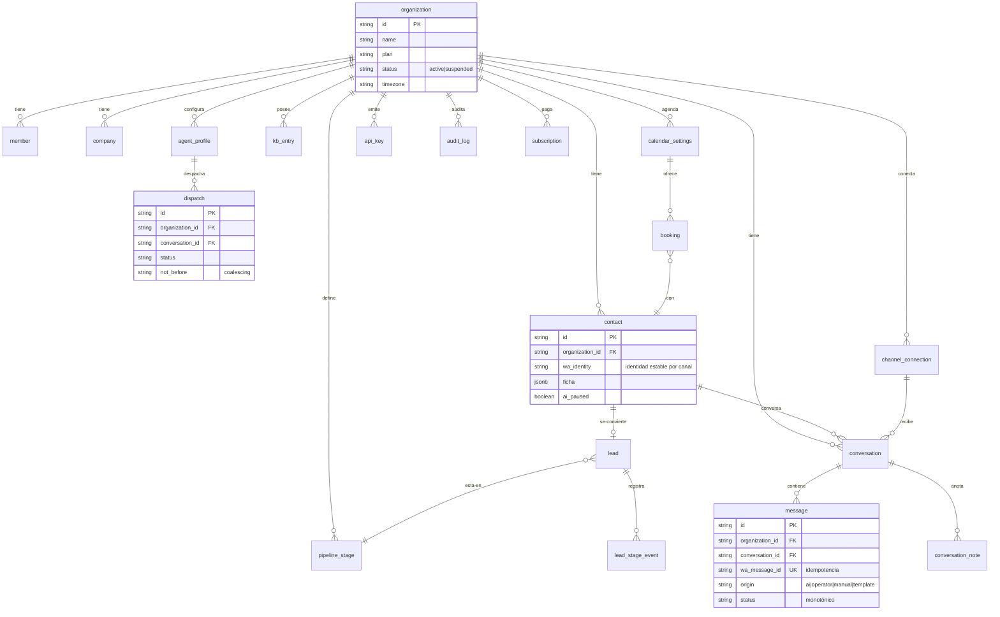

# MODELO_MULTI_TENANT.md

**Proyecto:** Construcción del nuevo CRM SaaS multi-tenant
**Fase:** 3 — Modelo de aislamiento multi-tenant
**Fecha:** 2026-11-27
**Decisión base acordada:** PostgreSQL compartido con **Row-Level Security (RLS)** por `organization_id`. Alternativas (schema por tenant, BD por tenant) quedan como variantes futuras para planes enterprise y se describen en §10.

## 1. Principios

1. **La organización ES el tenant.** Toda entidad empresarial pertenece a una organización; no existen datos «globales de negocio» sin dueño.
2. **El aislamiento se aplica en la base de datos, no solo en el frontend.** Aunque una consulta se escape de la capa de aplicación, PostgreSQL la bloquea por política.
3. **El contexto de tenant es explícito y obligatorio** en cada llamada: HTTP → servicio → worker → job → SSE → MCP → webhook. Nadie «hereda» una organización por accidente.
4. **Fail-closed:** si una operación no puede determinar su organización, falla; nunca ejecuta «sin filtro».
5. **El aislamiento se demuestra con pruebas automatizadas** que intentan acceder a recursos de otro tenant y comprueban el bloqueo (precedente ya probado en el ecosistema: suites de aislamiento multiorg de CRM-ALBRA; aquí se elevan a nivel de BD con RLS).

## 2. Modelo de organizaciones

```
Organization (tenant)
├── Usuarios y roles de equipo (owner / admin / member; RBAC fino + 2FA en F5)
├── Agentes lógicos (perfil + especialización + herramientas autorizadas)
├── Contactos, empresas, leads, cotizaciones, productos, tareas
├── Conversaciones y canales conectados (credenciales propias cifradas)
├── Conocimiento, automatizaciones, campañas, calendarios
├── Memoria del agente (aislada, ver §6)
├── Integraciones y llaves API
├── Plan, límites de consumo y facturación
└── Auditoría propia (append-only tamper-evident)
```

Identidad compartida del ecosistema: el `organization_id` (IDs con prefijo, patrón ya usado por VOCERO con nanoid) es la **misma identidad** que el adaptador del agente, el motor de flujos y el motor de campañas propagan en cada llamada (hereda el precedente `X-Albra-Org` de CRM-ALBRA y las PK compuestas por org de WHATSPOWER/ULTRA).

## 3. Aislamiento por niveles (el listado del mandato, sección 7)

| Nivel | Mecanismo | Detalle |
|---|---|---|
| **Base de datos** | RLS por `organization_id` en todas las tablas de dominio + `scoped()` en la capa de aplicación (doble valla) | §4 |
| **API** | Resolución de tenant desde la sesión (cookie/usuario) o desde la llave/token (cada llave nace de un usuario de una organización); cross-tenant por parámetro = 403 + auditoría | §5 |
| **Procesos asíncronos** | Cada job/outbox guarda `organization_id` y se ejecuta con el contexto fijado (`SET LOCAL app.current_org`) | §5.3 |
| **Workers** | Pool por inquilino no requerido; workers globales que leen trabajos con org y **fijan el contexto antes de tocar datos**; round-robin equitativo por organización (patrón probado por el worker de ULTRA) | §5.3 |
| **Memoria del agente** | Aislamiento por organización vía mapeo explícito y backend de memoria Postgres tenant-safe (extensión prevista por `docs/MEMORY.md` del agente) | §6 |
| **MCP** | El servidor MCP del CRM actúa siempre bajo la llave/usuario que lo invoca (misma resolución de tenant que la API v1); ninguna herramienta MCP cruza organizaciones | §5.4 |
| **Conectores** | Credenciales por organización cifradas (AES-256-GCM); el adaptador jamás reutiliza credenciales entre tenants | §7 |
| **Archivos** | Rutas/objetos prefijados por `organization_id` en disco o bucket; sin listado global; borrado por tenant (derecho al olvido) | §7 |
| **Webhooks** | Token por conexión (segmento de URL por organización/conexión) + firma del proveedor; un webhook no resuelve otra organización | §7 |
| **Cachés** | Todas las claves de caché incluyen `organization_id` (`org:{id}:...`); invalidación por tenant; sin cachés de datos cruzados en cliente (patrón PWA de VOCERO: sin datos en el dispositivo) | §7 |

## 4. RLS en PostgreSQL

### 4.1 Roles y sesión de aplicación

```sql
-- Rol de aplicación sin privilegios de dueño; la app se conecta con este rol
CREATE ROLE app_runtime NOLOGIN;
GRANT USAGE ON SCHEMA public TO app_runtime;
GRANT SELECT, INSERT, UPDATE, DELETE ON ALL TABLES IN SCHEMA public TO app_runtime;

-- El rol de migraciones (DDL) es distinto y no se usa en runtime
CREATE ROLE app_migrations NOLOGIN;  -- dueño de los objetos
```

### 4.2 Política estándar de tenant

```sql
-- Toda tabla de dominio lleva organization_id NOT NULL + índice org-first
-- (el esquema de VOCERO ya está en ese estado en 40/43 tablas; las 3 restantes
--  son de sesión de auth y quedan fuera del modelo de tenant).

ALTER TABLE contact ENABLE ROW LEVEL SECURITY;
ALTER TABLE contact FORCE ROW LEVEL SECURITY;  -- también para el dueño de la tabla

CREATE POLICY tenant_isolation ON contact
  USING      (organization_id = current_setting('app.current_org', true))
  WITH CHECK (organization_id = current_setting('app.current_org', true));
```

- `current_setting('app.current_org', true)` con `true` devuelve `NULL` si no se fijó → la política no coincide → **cero filas** (fail-closed).
- La aplicación ejecuta al inicio de cada transacción: `SET LOCAL app.current_org = '<orgId>'` (por transacción, sin fugas de pool).
- La capa de aplicación mantiene además `scoped()` (todo query pasa por el helper que exige organización) — **doble valla**: si la política se elude por error de roles, el helper falla; si el helper falla, la política bloquea.

### 4.3 Super-admin (administración global)

```sql
CREATE POLICY super_admin_access ON contact
  USING (current_setting('app.super_admin', true) = 'on'
         AND current_setting('app.super_admin_org', true) = 'platform');
```

- El super-admin accede **con su propio rol de BD** (`app_super`) y **con acción auditada obligatoria** (cada acceso lleva `switch-organization` y queda en `audit_log` con motivo). Patrón probado: super-admin con `switch-organization` de CRM-ALBRA.
- Nunca se conecta con el rol de migraciones.

### 4.4 Reglas de esquema

1. Toda tabla de dominio: `organization_id NOT NULL REFERENCES organization(id)` + índice `org-first`.
2. **Unicidades siempre por organización** (compuestas): p. ej. contacto único por `(org, canal, identidad)` — patrón ya existente en VOCERO; llave API única por org; slot de cita único por org.
3. Tablas compartidas de plataforma (catálogo de planes, versiones) viven en un schema separado sin RLS de tenant, de solo lectura para `app_runtime`.
4. Ninguna migración destructiva sin backup previo, revisión y prueba en entorno de staging (`REPOSITORIOS_AUDITORIA.md` §5 y política heredada del mandato).

## 5. Propagación del contexto de tenant

### 5.1 HTTP (núcleo)

1. Middleware resuelve la organización: sesión de usuario → su organización activa; llave API → la organización de su creador; token OAuth → la del grant; webhook → la organización de la conexión del canal (por token de URL/credencial). El desajuste por parámetro (`?org=`) es 403 `tenant_mismatch` + auditoría (código heredado del ecosistema: `TENANT_MISMATCH` fail-closed en WHATSPOWER/ULTRA).
2. El contexto se fijó en `AsyncLocalStorage`: `{ organizationId, actorType: 'user'|'api_key'|'agent'|'webhook', actorId, scopes, requestId }`.
3. Cada consulta abre transacción con `SET LOCAL app.current_org`.

### 5.2 Llamadas a servicios satélite

Toda llamada saliente (al agente, a flujos, a campañas) incluye en el cuerpo/cabecera: `organizationId`, identidad del agente lógico, identidad del usuario cuando corresponda, scopes y firma HMAC. Los satélites **verifican el eco** de la organización en las respuestas (fail-closed `tenant_mismatch`) — patrón ya probado en el ecosistema (verificación de eco de org en el puente de CRM-ALBRA y en los checks de ULTRA).

### 5.3 Workers y jobs

- El trabajo persiste `organization_id` en la fila (outbox, webhook_event, job).
- El worker lee el trabajo, **fija el contexto de BD y de AsyncLocalStorage** con esa organización y solo entonces ejecuta.
- Equidad: round-robin por organización (un tenant grande no acapara el worker — patrón del worker persistente de ULTRA).
- Las colas compartidas (si se añade una externa, ADR-N2) llevan el org en el mensaje y revalidan en el consumidor.

### 5.4 MCP y API pública

- El MCP del CRM resuelve tenant como la API v1 (llave/OAuth) — **sin excepción**; cada herramienta MCP ejecuta el mismo handler de dominio con el contexto fijado.
- El agente nunca recibe credenciales de BD: consume por contratos (`CONTRATOS_INTEGRACION.md`) y su identidad de agente está autorizada por organización (agente lógico del tenant).

## 6. Memoria y conocimiento del agente por tenant

AGENTE-GENERAL aísla memoria por `(agent_id, domain, user_id, context_id)` pero **no tiene org_id**, y su memoria vive en SQLite local. Decisión:

1. **Mapeo de tenant → espacio del agente:** `agent_id = "org:<organizationId>"` (y para agentes lógicos: `"org:<organizationId>#<agentLogico>"`), `domain = "crm"`. La inyección del aislador de memoria del agente rechaza accesos fuera del espacio (violación → `PermissionError` — comportamiento ya implementado por `MemoryIsolator`).
2. **Backend de memoria en Postgres (tenant-safe):** se registra un `MemoryStore` propio del CRM (el `docs/MEMORY.md` del agente prevé explícitamente añadir backends desde la capa de especialización) que:
   - guarda en la BD del CRM (tablas `agent_memory`, **org-scoped y con RLS**),
   - mantiene la disciplina del agente (procedencia, evidencia, ciclo de vida, derecho al olvido),
   - elimina la memoria en SQLite de producción para datos de negocio.
3. **Conocimiento comercial desacoplado:** la base de conocimiento vive en el CRM (`kb_entry`, org-scoped) y el agente la consulta por contrato (`GET /v1/knowledge`). Ningún conocimiento empresarial queda acoplado al modelo de IA ni a un agente específico: cualquier agente compatible con el contrato puede consumirlo.
4. **Aprendizaje del agente:** lo que el agente aprende de una conversación (fichas, decisiones) se devuelve al CRM por contrato (`PUT /api/bot/ficha` y su equivalente v1) y queda en el tenant; la memoria episódica del agente solo vive en su espacio `org:*`.

## 7. Conectores, archivos, webhooks y cachés

| Elemento | Regla de aislamiento |
|---|---|
| Credenciales de canales/calendarios/IA/CAPI | Una fila por organización con token cifrado (AES-256-GCM); el runtime solo las descifra dentro de la transacción del tenant; jamás se reutilizan entre orgs |
| Archivos de media | Ruta/objeto `org/{organizationId}/{assetId}`; la descarga exige sesión/llave del mismo tenant; el borrado por organización incluye sus objetos (derecho al olvido) |
| Webhooks entrantes | Segmento de URL por conexión + firma del proveedor; la conexión determina la organización; un evento cuya huella ya existe se descarta (idempotencia) |
| Webhooks salientes (a flujos/campañas/agente) | Firma HMAC con secreto por organización + `X-Timestamp` + anti-replay durable |
| Cachés de aplicación | Clave `org:{id}:{entidad}:{params}`; TTL por tipo; invalidación dirigida; **sin caché de datos de cliente en el navegador** (patrón PWA VOCERO) |
| Cachés de proveedor externo (CDN) | Solo assets públicos de marca; los datos de negocio nunca en CDN |

## 8. Límites y cuotas por organización

| Recurso | Control | Comportamiento al agotar |
|---|---|---|
| Usuarios activos | Límite del plan | Bloqueo de invitación con mensaje claro |
| Conversaciones/mes | Contador por org (`usage_record`) | Modo «solo humano» con aviso; nunca pérdida de mensajes |
| Envíos por minuto | Rate limit por org y por llave (compatible multi-replica) | 429 + `Retry-After` |
| Consumo de IA | Contador por org (tokens/llamadas reportados por el adaptador) | Aviso y, según plan, pausa del interruptor IA (`ai_paused`) |
| Agentes lógicos | Límite del plan | Alta bloqueada con upgrade |
| Campañas | Límite por plan (envíos/mes) en el motor | Pausa de campaña con motivo |
| Almacenamiento | Cuota por org | Bloqueo de nuevos adjuntos con aviso; lectura siempre disponible |

## 9. Batería de pruebas de aislamiento (obligatoria en CI)

Inspirada en las suites negativas ya probadas en el ecosistema, elevada a nivel de BD:

| # | Prueba | Resultado esperado |
|---|---|---|
| T1 | RLS directo: `SET app.current_org=A` y `SELECT`/`UPDATE`/`DELETE` sobre filas de org B en cada tabla de dominio | 0 filas afectadas |
| T2 | Sin contexto: query sin `SET app.current_org` con rol `app_runtime` | 0 filas (fail-closed) |
| T3 | Sesión de usuario de org A pidiendo recursos de org B por API (path param manipulado) | 403 `tenant_mismatch` + auditoría |
| T4 | Llave API de org A contra recursos de org B | 403 |
| T5 | Token OAuth emitido para org A usado contra org B | 403 |
| T6 | Webhook de canal de org A con token de conexión de org B | 404/403 + evento registrado |
| T7 | Worker procesando job con org manipulada en el payload | Rechazo + auditoría (el job revalida contra BD) |
| T8 | MCP con llave de org A invocando herramienta con id de contacto de org B | 403 |
| T9 | Memoria del agente: acceso al espacio `org:B` desde ejecución autorizada para `org:A` | `PermissionError` |
| T10 | Descarga de media de org B con sesión de org A | 404 (no 403, para no revelar existencia) |
| T11 | Archivo en ruta de org B intentado listar/leer desde contexto org A | Denegado |
| T12 | Caché: warm de org A no sirve respuesta a org B | Miss para org B |
| T13 | Export/backup solicitado por admin de org A | Solo contiene org A |
| T14 | Borrado de conversación de org B por sesión de org A | 403 + auditoría |
| T15 | Unicidades: crear contacto/conversación/cita idéntica en orgs distintas | Permitido (unidades por org, no globales) |

Todas se ejecutan en CI contra PostgreSQL real (no SQLite) y fallan el pipeline si alguna bloquea el paso. Este es el requisito del mandato: «pruebas automatizadas que intenten acceder a recursos de otro tenant y demuestren que el acceso está bloqueado».

## 10. Variantes futuras por plan

| Variante | Cuándo | Coste | Riesgo |
|---|---|---|---|
| BD compartida + RLS (base) | Todos los planes estándar | Bajo | Mínimo con doble valla + tests T1-T15 |
| Schema por tenant | Organizaciones enterprise con exigencia contractual de separación lógica | Medio (migraciones N×, conexión por schema) | Deriva de esquemas — requiere orquestación de migraciones |
| BD por tenant | Enterprise premium / requisitos regulatorios específicos | Alto (operación, backups N×, aggregates complejos) | Aislamiento máximo; reportes cross-tenant vía warehouse |

La plataforma mantiene la abstracción del contexto de tenant de forma que una organización «premium» pueda migrarse a variante dedicada sin reescribir el dominio (el `organizationId` es la llave en todos los casos).

## 11. Diagrama del modelo núcleo (ER simplificado)



## 12. Checklist de aceptación multi-tenant (Fase 5)

- [ ] RLS habilitado con `FORCE` en todas las tablas de dominio; políticas generadas y revisadas por migración.
- [ ] `scoped()` obligatorio con test de vigilancia que falla ante cualquier query de dominio sin organización (patrón de vigilancia ya usado por VOCERO en la bitácora de etapas).
- [ ] Contexto de tenant en AsyncLocalStorage propagado a workers, jobs, SSE, MCP y satélites.
- [ ] Batería T1-T15 en CI sobre PostgreSQL real, en verde.
- [ ] Credenciales, media, webhooks y cachés org-scoped verificados por prueba.
- [ ] Super-admin con switch-organization auditado y rol de BD propio.
- [ ] Backups con restauración verificada por tenant (drill) y ninguna migración destructiva sin backup + prueba.
- [ ] Documentación de tenant actualizada y publicada junto al código.
